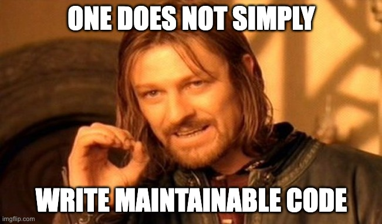
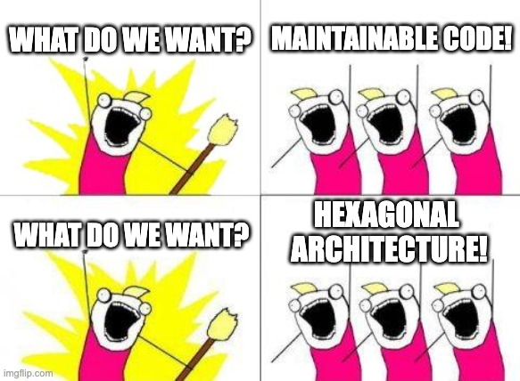
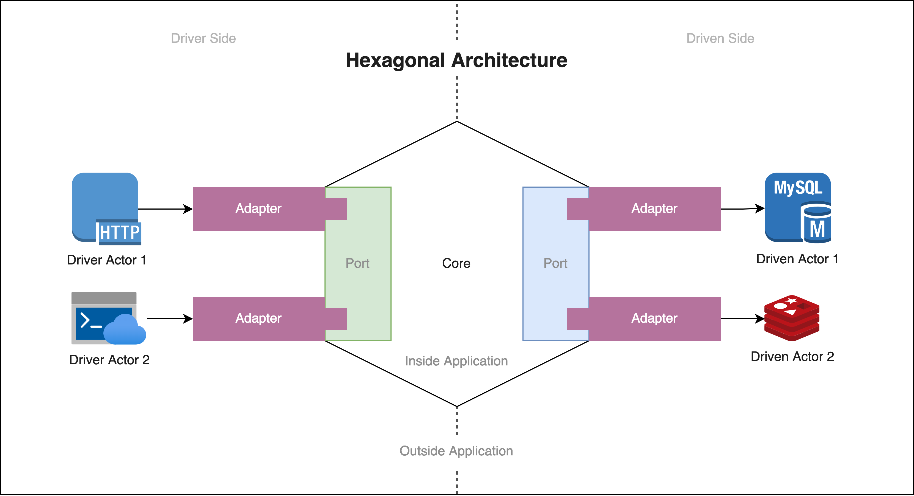
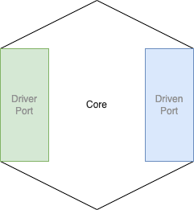
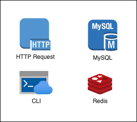
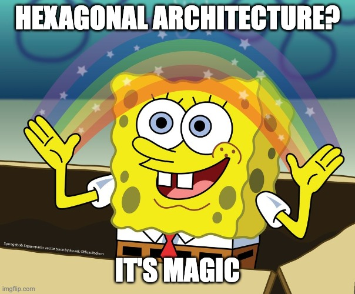

# Hexagonal Architecture

## Background Story

In Solutions Team, we always try to work with small applications. Even in relatively complex systems such as `Haraj Bill` or `Chat Next`, we always try to break them down into much smaller applications depending on the focus of their business use cases.

The reason why we are doing it like this is because small applications will have much less code rather than the big ones. Less code means less complexity in maintaining it. So when the application requires a bug fix or a new feature, it will be much easier to write the necessary changes.

However, since we will have a lot of small applications, we need some standard architecture on how to write them. This is so everyone in the Solutions Team can easily understand them even if they never work with those applications before (a.k.a maintainable code).

<p align="center">
    
</p>

On top of that, we also need to automate the testing for our code. This is to ensure our changes (especially bug fix) is working as expected and it doesn't break existing application functionalities.

After studying several architectural patterns, we discovered that `Hexagonal Architecture` is the most suitable architecture for our workflow in Solutions Team.

## Why Hexagonal Architecture?

Unlike its sibling architectures (`Clean Architecture` & `Onion Architecture`) which focus on layers, `Hexagonal Architecture` focuses on application logic (how the application behaves on its use cases). This makes the application created using it very easy to understand, even by someone who just got started in Solutions Team.

When everyone on the team can easily understand our code, they will be able to handle its maintenance. This means when we are getting sick or going on vacation, someone from our team can easily cover our back. This is what it means to have maintainable code.

On top of that, `Hexagonal Architecture` provides an excellent way to write automated tests for our code. This is because it clearly separates the application logic from its dependencies. So we can easily mock the dependencies when writing the tests.

<p align="center">
    
</p>

However the concrete implementation of `Hexagonal Architecture` could vary between team to team.

This is because `Hexagonal Architecture` is more like a set of fundamental principles rather than a complete recipe. This is why when we read online articles about its concrete implementation, the authors usually come up with their own ways to implement it.

This is also the reason why we suggest you to use this document as your primary reference when learning about `Hexagonal Architecture`. Yeah, this is because when you search for it online, everyone has their own ways to implement it including the Solutions Team.

In the upcoming sections, we will discuss the details of `Hexagonal Architecture` implementation that suitable for Solutions Team projects. To make it easy to understand, we will use `Hex Monscape` as our implementation example.

## What is Hexagonal Architecture?

<p align="center">
    
</p>

`Hexagonal Architecture` is an architectural pattern that puts the application logic at the center of everything in the application codebase.

There are `3` main principles we need to follow when we want to implement this architecture:

1. Clearly divide between the `inside` & `outside` of the application. `Inside` of the application is every component constructing the application logic where `outside` is the otherwise.
2. Dependencies on `inside` & `outside` boundaries should always point towards `inside` components. So `outside` components must always refer to `inside` components, not the other way around.
3. Isolate boundaries between `inside` & `outside` components using ports & adapters.

From these principles, we can infer `4` constructing pillars of `Hexagonal Architecture`:

- [Core](#core) => A group of components constructing our application logic. This is the `inside` of our application.
- [Actors](#actors) => Any external entities interacting with our application.
- [Ports](#ports) => Interfaces that specify how [Actors](#actors) can interact with [Core](#core). This is the boundary between the `inside` & `outside` of our application.
- [Adapters](#adapters) => Implement specification provided by [Ports](#ports) so [Actors](#actors) can interact with [Core](#core) and vice versa.

Each of these pillars will be explained thoroughly in the upcoming sections.

## Core

`Core` is where our application logic lives. Application logic describes **how the application behaves** when handling each of its use cases, for example: "when the player attacks, the enemy takes damage, and if the enemy's health reaches zero the player wins the battle".

<p align="center">
    
</p>

`Core` consists of `3` components:

- `Service` => Handles the use cases of the application. Each method represents one use case, e.g. `StartBattle()`, `Attack()`, & `Surrender()` in [`battle.Service`](../../internal/core/service/battle/service.go#L20-L44). The behavior of each use case is written in its implementation.
- `Entity` => Data models used by `Service` to run the use cases, e.g. `Battle`, `Game`, & `Monster` in [here](../../internal/core/entity/).
- `Storage` interfaces => What `Service` needs from the outside world (e.g. database), defined in [here](../../internal/core/service/battle/storage.go) & [here](../../internal/core/service/play/storage.go). These are our `Driven Ports`.

To find the `Core` components of our application:

1. Look at the [API specification](../api/rest-api.md) and group the endpoints by context. In `Hex Monscape` there are `2`:
    - `Play context` => starting a new game and progressing it.
    - `Battle context` => battling an enemy with the monster partner.
2. For each context, define a `Service` interface with one method per use case, and describe the expected behavior of each method in comments (like [here](../../internal/core/service/play/service.go#L22-L23)). Trust me these comments will greatly help keeping our head in straight line when implementing these methods. This interface is our `Driver Port`.
3. Implement the `Service` interface (like [here](../../internal/core/service/battle/service.go#L46-L195) & [here](../../internal/core/service/play/service.go#L31-L81)). While implementing it, define the `Entity` it needs and the `Storage` interfaces for anything external.

> **Note:**
>
> Sometimes we face confusion when we are in step `3`. Usually this is because we find it difficult to find relationship between each `Core` components. In such case, try to utilize class diagram just like what we did in [here](../diagrams/class-diagram.png). This will greatly help us in mapping out the relationship between each `Core` component.

## Actors

Actors are external entities that interact with our application.

<p align="center">
    
</p>

There are `2` types of actors:

- `Driver Actor` => Actor that initiates interaction with our application.
- `Driven Actor` => Actor that being called by our application as the result of interaction with `Driver Actor`.

In the case of `Hex Monscape`, the incoming HTTP requests are the examples of `Driver Actor` while the `MySQL` database is the example of `Driven Actor`.

## Ports

Ports are interfaces defined inside [Core](#core) that define how [Actors](#actors) can interact with [Core](#core) components & vice versa.

There are `2` types of ports:

- `Driver Port` => Ports for defining interaction between driver actor & core.
- `Driven Port` => Ports for defining interaction between core & driven actors.

In the case of `Hex Monscape`, the examples for `Driver Ports` are [`battle.Service`](../../internal/core/service/battle/service.go#L20-L44) & [`play.Service`](../../internal/core/service/play/service.go#L18-L29).

As for the examples for `Driven Ports` are all interfaces defined in [here](../../internal/core/service/battle/storage.go) & [here](../../internal/core/service/play/storage.go).

## Adapters

Adapters are the components used to translate interaction from [Actors](#actors) to [Core](#core) components & vice versa. They implements [Ports](#ports) defined in the [Core](#core).

There are `2` types of adapters:

- `Driver Adapter` => Adapter for translating interaction from the `Driver Actor` into a call acceptable by application core.
- `Driven Adapter` => Adapter for translating the command given by application core to `Driven Actor`.

In the case of `Hex Monscape`, the example for `Driver Adapters` is [`rest.API`](../../internal/driver/rest/api.go).

As for the examples for `Driven Adapters` are [`battlestrg.Storage`](../../internal/driven/storage/memory/battlestrg/storage.go), [`gamestrg.Storage`](../../internal/driven/storage/memory/gamestrg/storage.go), & [`monstrg.Storage`](../../internal/driven/storage/memory/monstrg/storage.go).

## Conclusion

Creating an application with `Hexagonal Architecture` is very simple:

1. Start from the `Service`, since it maps directly to the use cases described in our PRD or API design.
2. While implementing the `Service`, create the other `Core` components it needs (`Entity` & `Storage` interfaces).
3. Implement the `Adapters` so the `Core` can talk to the outside world. Voila, we have our application ready! 😁

Understanding applications created using `Hexagonal Architecture` is also straightforward:

1. Start from the `Service` to learn the use cases of the application.
2. Continue to the other `Core` components (`Entity` & `Storage` interfaces) to see what each use case needs.
3. Now we know **what** the application does! 😁 If we want to know **how** it talks to the outside world (e.g. REST API or MySQL), we just need to look at the `Adapters`.

This is why in Solutions Team we choose `Hexagonal Architecture` as our default architecture when building our applications. Yeah, because it enables us to create maintainable code much more quickly! 😁

<p align="center">
    
</p>

To learn how to apply `Hexagonal Architecture` in the new Solutions Team project, please refer to [Project Methodology](./project-methodology.md) document.

## Extra: Relation with DDD

`Domain-Driven Design` (`DDD`) & `Hexagonal Architecture` are commonly paired, so people often mix them up. In reality they solve different problems:

- `Hexagonal Architecture` => Tells us how to **structure** the application, which is separating the `Core` from the outside world using ports & adapters.
- `DDD` => Tells us how to **model the business domain** inside the `Core`.

The difference becomes clear when we compare how the code is organized. Here is `Hex Monscape` today (`Hexagonal Architecture` only) compared to how it would roughly look with `DDD` applied inside the `Core`:

```
Hexagonal Architecture only           Hexagonal Architecture + DDD
---------------------------           ----------------------------
internal/                             internal/
├── core/                             ├── battle/            <- one folder per bounded context
│   ├── entity/                       │   ├── domain/
│   │   ├── battle.go                 │   │   ├── battle.go          <- aggregate root
│   │   ├── game.go                   │   │   ├── health.go          <- value object
│   │   └── monster.go                │   │   ├── damage.go          <- value object
│   └── service/                      │   │   ├── events.go          <- domain events
│       ├── battle/                   │   │   └── repository.go      <- one repository per aggregate
│       │   ├── service.go            │   └── application/
│       │   └── storage.go            │       ├── attack.go          <- one handler per use case
│       └── play/                     │       └── ...
│           ├── service.go            ├── play/
│           └── storage.go            │   ├── domain/ ...
├── driver/                           │   └── application/ ...
└── driven/                           ├── driver/
                                      └── driven/
```

Beside the extra folders, `DDD` also adds rules on how these components should interact. For example, in the `Attack()` use case:

- In our current code, [`battle.Service`](../../internal/core/service/battle/service.go#L143-L170) loads the battle, executes the attack, saves the battle, and directly increments the number of battles won in `Game` when the player wins.
- In `DDD`, `Battle` & `Game` would belong to different aggregates (even different bounded contexts), so `Battle` is not allowed to update `Game` directly. Instead, `Battle` publishes a `BattleWon` event, and a separate handler in the `play` context listens to it to update `Game`. Values like health & damage would also get their own types (value objects) instead of plain `int`.

These rules are useful for protecting the consistency of a large & complex business domain. However they come with the cost of more files, more concepts, & more indirection to follow.

This is why `Hexagonal Architecture` without `DDD` is our default in Solutions Team. Our applications are small & their business rules are simple, so `Service` + `Entity` + `Storage` interfaces are already enough to express how the application behaves. Adding `DDD` on top of it would only make the code harder to understand for teammates who need to maintain it, which goes against our goal of having maintainable code.

## References

- https://alistair.cockburn.us/hexagonal-architecture/
- https://blog.octo.com/en/hexagonal-architecture-three-principles-and-an-implementation-example/
- https://www.youtube.com/watch?v=oL6JBUk6tj0
- https://medium.com/@matiasvarela/hexagonal-architecture-in-go-cfd4e436faa3
- https://medium.com/ssense-tech/hexagonal-architecture-there-are-always-two-sides-to-every-story-bc0780ed7d9c
- https://medium.com/ssense-tech/domain-driven-design-everything-you-always-wanted-to-know-about-it-but-were-afraid-to-ask-a85e7b74497a
